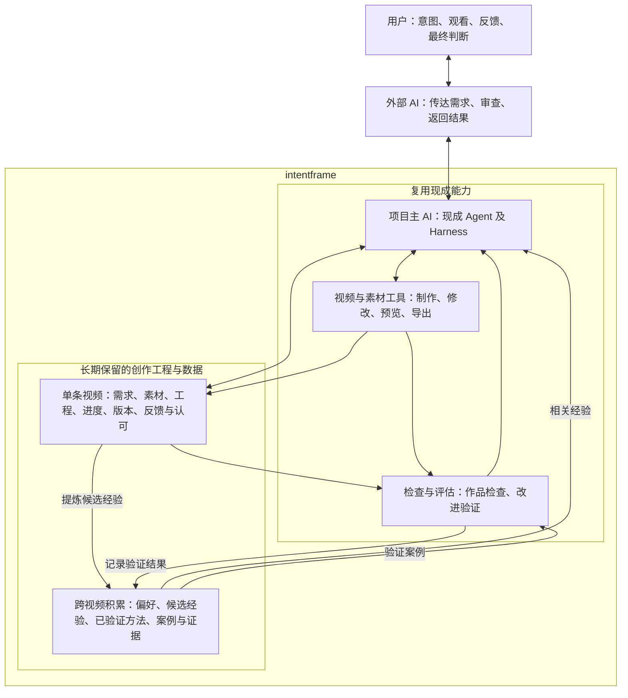

# intentframe

复用现成 AI 和视频工具，把创作意图变成视频，并通过反馈积累可验证的创作经验。

## 项目定位

intentframe 首先服务于创作者自己的持续视频创作：实现个人表达、建立影响力，并逐步让内容创作成为主要收入来源。未来是否为他人提供服务，在实际需要出现后再决定。

当前是项目初始化阶段。本仓库记录已经确认的目标、责任和边界，尚未实现视频生产流程，也没有确定具体技术栈。

## 工作原则

- 围绕真实视频推进。评价方案时，优先考虑作品是否符合意图、是否减少制作负担、经验能否改善下一次创作。
- 从 AI 的工作特点出发设计制作方式，不照搬传统视频制作流程或人类岗位划分。
- 基础设施优先复用。使用现成 Agent、Harness、制作及检查工具，不自建通用 AI 平台。
- 当前优先探索通过代码制作视频；按需要组合图片、视频、录屏、配音等素材，不要求所有画面都由代码绘制。
- 模型和工具可以更换。创作数据独立于具体 AI 保存，能够导出、迁移和接续使用。
- 每个增加的环节都要解决实际问题。能力提升后，可以替换、合并或删除多余环节。
- 区分用户明确要求、AI 建议和待验证假设，不把一次反馈自动固化为永久规则。

## 职责

| 参与者或能力 | 责任 |
| --- | --- |
| 用户 | 提出创作意图、观看实际视频、反馈并作最终判断 |
| 外部 AI | 传达需求与反馈、审查结果、向用户返回作品和说明 |
| 项目主 AI | 理解需求、澄清问题、决定制作方式、组织执行与修改；由现成 Agent 及其运行环境承担 |
| 生产能力 | 准备素材、制作、修改、预览及导出，优先复用现有工具 |
| 验证能力 | 检查作品要求、比较历史案例和新结果，判断改进或退步；人的观看判断仍是必要依据 |
| 项目数据 | 保留真实任务状态、作品版本、反馈、经验和验证证据，不依赖某段聊天记忆 |

项目主 AI 是职责，不绑定某个模型、供应商或平台。外部 AI 的审查不等于用户已经认可；认可对应具体作品版本，也不自动代表授权发布。

## 系统图

图表示必要职责和信息关系，不要求每个方框独立开发。验证案例应按用途提供；用于检验迁移效果的保留案例及其参考评价，不提前混入制作输入。

## 创作数据与持续改进

每次创作尽量关联以下内容：

1. 原始意图、参考、明确限制和澄清结果。
2. 素材、可修改的工程、实际视频和版本。
3. 用户针对具体版本或片段的原始反馈。
4. 实际修改内容、修改后的结果及用户是否认可。
5. 提炼出的候选经验、适用条件和验证证据。

经验是否有效，应通过后续作品和案例判断。重新渲染旧工程用于检查兼容性；从相同需求重新制作，才用于比较制作能力。未经人工修改的初稿与旧初稿比较，已认可成片作为目标参考，避免忽略历史人工投入。

长期保留的经验需要能够修正或撤销。AI 能读取记录不等于已经正确使用记录，记录数量也不等于创作能力提升。

## 当前边界

- 先完成真实视频的制作、观看、反馈、修改和经验复用。
- 不提前建设完整工作台、独立选题推荐系统或通用基础设施。
- Harness 的基本运行支撑需要保留，优先使用现成能力；复杂模型路由和内部多 Agent 分工，仅在实际收益明确时采用现成方案。
- 外部 AI 的连接方式、作品展示及反馈入口仍待调查和实际使用验证，不强行固定为纯聊天、独立页面或嵌入界面。
- 内容主题、受众、风格和商业方式可以在创作中探索，不作为开始制作的前置条件。

## 下一步

- 调查并试用现成制作组合，选择满足当前作品需要的最小方案。
- 完成一条真实视频并修改到用户满意，保留必要记录。
- 用后续视频检查经验能否复用，再决定是否补充能力。

## 仓库管理

GitHub 用于管理说明文档、制作代码、必要脚本及适合版本控制的创作记录。凭据、缓存和大体积媒体文件不直接提交；媒体保存位置、来源和版本关系应随创作工程记录，并另行备份。忽略文件不代表可以丢弃创作数据。

后续 AI 或协作者请先阅读 [AGENTS.md](./AGENTS.md)。
