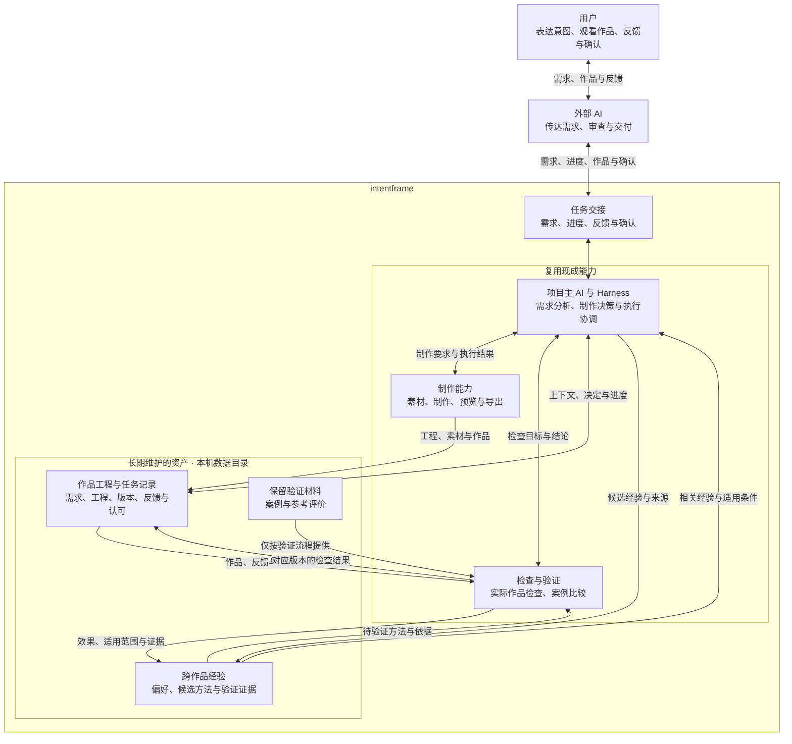

# 系统架构与技术选型

本页维护系统关系、技术选择、当前实现与下一步。项目目标与整体状态见[项目说明](../README.md)，长期协作要求见[协作约定](../AGENTS.md)。

设计文档只保留三个查阅入口：

| 要查什么 | 位置 |
| --- | --- |
| 系统边界、工具选择、本机接入与实现状态 | 本文 |
| 任务交接、自主范围、试做、审查、反馈、恢复与日志 | [制作与运行流程](./workflow.md) |
| 固定存储位置、记录、接续修改、备份与经验积累 | [数据与经验](./data.md) |

下述职责、规则与技术选择为已确认的设计要求，不代表代码已全部满足。实际能力与缺口以[当前实现与下一步](#当前实现与下一步)和[本机制作验证](#本机制作验证)为准；各文档的“待落实”区分实现缺口与仍需设计、验证的事项。

## 系统边界

用户掌握表达方向与最终判断；外部 AI 传达需求和反馈、审查并返回作品。intentframe 复用现成 Agent 与 Harness 承担主 AI，组织制作、检查、修改与经验验证，长期维护作品工程和跨作品积累。

图中分组表示逻辑职责与资产归属，不要求独立服务、进程或 Agent。“长期维护的资产”统一存放于本机数据目录，按[数据管理约定](../AGENTS.md#数据管理)保存，不纳入 Git 或上传远程仓库。任务交接定义动作与含义，只在确有需要时补充适配代码。具体工具及 Mac 上的执行、交付方式见[已选技术](#已选技术)。

## 架构图



## 系统目录

当前采用一个 TypeScript 工程，按项目需要的衔接职责组织源码。目录表示代码归属，不表示独立服务或多个 Agent；制作决策仍由现成 Agent 承担。

| 位置 | 负责什么 |
| --- | --- |
| [src/mcp/](../src/mcp/) | 面向外部 AI 的任务工具入口，检查交接参数并返回进度、结果和错误 |
| [src/runtime/](../src/runtime/) | 接入 Codex app-server，关联任务与原生会话、执行事件及恢复状态 |
| [src/records/](../src/records/) | 读写任务、版本、反馈、确认和经验记录，维护标识与引用；数据本身存放在独立创作目录 |
| [src/media/](../src/media/) | 适配 Remotion、FFmpeg/ffprobe 等现成能力，处理预览、导出与媒体技术检查 |
| [scripts/](../scripts/) | 可直接运行的验证和维护入口，现有本机接入测试保留在这里 |
| [tests/](../tests/) | 系统模块和组合行为的测试代码、可复用的合成测试夹具；实际执行记录存入本机数据目录 |
| [docs/](./) | 系统架构、制作运行流程、数据与经验三份设计文档 |

四个源码目录已有最小实现，可从 [CLI](../src/cli.ts) 与 [MCP 入口](../src/mcp/server.ts)进入。经验仍采用文件入口，尚未实现自动经验检索或验证。

经验内容、视频工程和媒体文件使用[固定数据入口](./data.md#固定存储位置)。检查与经验验证的 AI 判断按[制作流程](./workflow.md)执行，必要的记录和工具接入分别归入上述职责，当前不为每个逻辑角色另建模块。

[TypeScript 配置](../tsconfig.json)覆盖源码、脚本和系统测试；实际作品与执行证据不在系统工程内。当前由 Node 直接执行 TypeScript，命令和服务入口见[运行入口](#运行入口)。

## 运行入口

工具位置与来源由 [toolchain.json](../toolchain.json) 管理，库版本由 [package-lock.json](../package-lock.json) 锁定。当前环境为 Apple Silicon Mac；独立工具安装在 `/Users/yan/ercheng/intentframe-tools/`，没有修改系统全局 PATH。

```sh
# 检查工具和数据入口
./scripts/intentframe doctor

# 启动本机 stdio MCP
./scripts/intentframe mcp

# 直接调用同一套工具，参数来自 JSON 文件
./scripts/intentframe call get_work /绝对路径/任务参数.json

# 类型与业务规则检查
export PATH="/Users/yan/ercheng/intentframe-tools/bin:$PATH"
npm run check
npm test

# 本机备份、恢复到新目录并逐文件核对
npm run backup:local
```

真实 MCP 协议的命令行客户端为 [mcp-call.ts](../scripts/mcp-call.ts)：使用固定 Node 执行 `scripts/mcp-call.ts <工具名> <输入 JSON> [输出 JSON]`。作品标识从创建结果或[数据入口](../../intentframe-data/README.md)取得。

[工具入口](../src/mcp/server.ts)公开 `get_runtime_info`、`list_works`、`create_work`、`get_work`、`produce_version`、`render_version`、`submit_feedback`、`record_review`、`confirm_version`。命令行 MCP 客户端先核对服务数据目录，再调用请求工具；新会话可列出作品后查询。完整制作保留用户方向确认门槛，审查和用户认可分别保存。

`produce_version` 默认延续最新有可核对源码的版本；指定历史 `baseVersionId` 时须同时提供 `baseReason`。传入 `feedbackId` 选择一条反馈，否则处理基线尚未包含的反馈；原始反馈始终保留在制作上下文中。返回结果须按[执行结果的含义](./workflow.md#执行结果的含义)读取，不能只看工具调用是否返回。

`npm test` 使用合成夹具和本地 Codex 协议替身，不消耗模型额度；媒体与备份回归实际调用已安装的 Remotion 浏览器、FFmpeg 和 Restic，因此需要上述 Apple Silicon Mac 环境与工具。临时测试目录自动清理，具体执行证据按[系统测试记录](./data.md#系统测试记录)保存在本机。

[VS Code 配置](../.vscode/mcp.json)已提供启动命令。本轮通过当前会话调用 MCP SDK 客户端完成真实任务；VS Code/ChatGPT 原生工具列表的发现、信任与直接调用尚未验证。配置文件存在不表示客户端已经接通。等待超时后应先查询任务状态，不能盲目重发。

### 工具与依赖管理

- Node 24.22.1、Codex 0.163.0、Restic 0.19.1 使用固定工具位置。Node 与 Restic 下载时核对了官方 SHA-256；Codex 通过固定版官方 npm 包安装。
- Remotion、bundler、renderer 与 Mac 媒体包锁定为 4.0.541，React/React DOM 为 19.3.1。FFmpeg/ffprobe n7.1 随媒体包提供，动态库路径只传给对应子进程。
- 渲染浏览器由 Remotion 下载和管理。当前未下载大型生成模型或第三方项目源码；按任务需要再增加。
- JavaScript 依赖可用 `npm ci --ignore-scripts` 复现；浏览器用 Remotion 的 `ensureBrowser()` 准备。工具路径变化先查配置和 doctor，不依赖应用内部缓存目录。

## 已选技术

| 部分 | 选择 | 职责与边界 |
| --- | --- | --- |
| 项目语言与运行环境 | TypeScript + Node.js | 用于本机 MCP、任务记录和必要工具适配，与视频工程共用语言体系；不另设 Python 控制层。 |
| 项目主 AI | 官方 Codex Agent/Harness，通过 app-server 接入 | 复用官方会话、执行事件、权限和恢复能力；本机适配与 app-server 优先通过 stdio 交互。 |
| 外部 AI 接口 | 本机 MCP，使用官方 TypeScript MCP SDK | 由外部 AI 已有的 Mac 访问能力调用；优先使用 stdio，实际客户端兼容性需验证。 |
| 视频制作与预览 | Remotion + React + TypeScript，使用 Studio 和渲染入口 | 编排画面、动画与时间线，提供预览和导出；不将固定模板作为能力上限。 |
| 媒体处理与技术检查 | FFmpeg + ffprobe | 处理音视频、读取规格及准备检查材料；不能代替内容与视听效果审查。 |
| 创作记录 | Markdown + JSON，所需运行事件按需使用 JSONL | 文件分工与查阅方式见[记录组织](./data.md#记录组织)。暂不引入普通数据库或向量数据库。 |
| 系统版本管理 | Git | 只管理系统源码、通用文档与配置、可复用测试；作品工程及其他长期资产使用本机数据目录和本机备份。 |
| 备份与恢复 | Restic | 同一台 Mac 的独立文件夹备份与恢复；配置和验证要求见[存储与备份边界](./data.md#存储与备份边界)。 |

TypeScript 接入依据所选版本的官方接口，优先复用已有 SDK 或官方生成的协议类型。不同语言的 SDK 不一定封装相同的交互能力，须核对实际覆盖范围。

Codex 模型和认证方式随可用账号配置；会员登录与 API 按量使用是不同路径，不将某个 GPT 会员套餐写成项目数据或工具接口的前置条件。外部 AI 入口的功能权限由所用客户端决定。

选型同时比较能力、适配难度、维护成本、实际费用与使用条件，付费与否不作为排除门槛。选定工具不代表授权新增采购或超出现有授权的调用费用。

## 本机运行与交付

**外部 AI 已有的 Mac 访问能力 → 本机 MCP → 项目主 AI 与制作检查工具 → 本机文件。**

- 工程、素材、工具执行、渲染和成片保留在 Mac；使用云模型时，推理仍通过所选服务进行。
- 复用现有本机访问能力，不新增公网接口、隧道或远程文件交付服务。
- 交付本机实际文件位置、对应版本及必要说明，由用户与外部 AI 在 Mac 上查看。文件存在、能够读取和能够实际观看分别验证。
- 操作目标须与明确配置的数据位置一致；跨客户端和子进程交接时仍须成立，不能静默退回其他目录。位置和权限见[作品记录](./data.md#固定存储位置)，本机访问能力不等于自动拥有所有目录权限。
- 成片交付不额外创建云端媒体副本，备份按[本机备份边界](./data.md#存储与备份边界)执行。

## 适配范围

项目只补任务交接、任务与原生会话关联、创作记录及必要工具调用的适配。Agent 运行循环、模型接入、权限执行与会话恢复优先交给现成运行器，不迁移旧工作台的业务运行框架。

技术日志保留 Harness 和工具的原生记录能力，JSONL 只用于项目确有需要的事件，不复制或转换全部原生日志。责任分工和保留要求见[日志与过程记录](./workflow.md#日志与过程记录)。

## 当前实现与下一步

固定工具与库版本、最小本机接口、作品版本目录和同机备份位置已落实。审查确认的九项问题已完成实现修复，回归覆盖原复现场景；真实 MCP、Codex 结构化结果与本机渲染也已验证。具体执行记录留在本机，以下仅描述当前能力与限制。

| 方面 | 当前实现 | 尚需注意的边界 |
| --- | --- | --- |
| 本机交接 | 显式传递项目配置，调用前核对服务实际数据目录。 | 客户端原生工具注册仍待验证。 |
| 制作与接续 | 修改起点与反馈目标分开，保留原始反馈和已处理关系；保存最终回复并校验结构化完成、阻塞或失败声明。 | 制作声明与内容质量仍需结合实际结果审查。 |
| 版本与产物 | 新版保存完整目录清单及依赖锁校验；复用成片检查来源和字节，实际读取帧率；缺失文件恢复须匹配原校验值。 | 当前验证限于本地工程；旧记录的证据覆盖范围见[版本对应与完整性](./data.md#版本对应与完整性)。 |
| 失败与恢复 | 只读预检先行，文件准备失败可定位并继续；日志失败不再使 RPC 无限等待，未知执行仍阻止盲目重发。 | 真实中断作业和遗留锁仍需核对，不自动解除。 |
| 本机备份 | 比较备份前、恢复结果和结束时源目录的完整清单与内容，检测到变化或执行锁不报告通过。 | 为同机文件夹备份，未配置定时或自动清理。 |

后续按真实作品需要验证素材、音轨和经验能力；不将接口回归通过当作这些能力的证明。

## 本机接入验证

文本接入测试已验证 MCP 调用、原线程恢复、新线程接续，以及部分明确失败与未知状态保护。实际执行记录仅保存在本机，位置见[系统测试记录](./data.md#系统测试记录)。

[接入回归脚本](../scripts/test-local-handoff.ts)复用[运行器连接](../src/runtime/codex-client.ts)。`--errors` 只检查异常路径，默认运行会使用现有 Codex 登录执行三个小文本任务。

## 本机制作验证

已通过简单图文任务验证本机制作、反馈修改、新会话接续和针对版本的用户确认。具体作品、版本、原始反馈、执行证据及认可状态从[本机数据入口](../../intentframe-data/README.md)查阅，不复制进系统仓库。

制作验证与故障回归只覆盖各自的任务和条件。音频、多素材工程、远程素材与动态加载、跨机器迁移、真实执行中断的自动核对恢复，以及 ChatGPT 原生工具注册仍待验证。

## 官方能力依据

以下为选型参考，具体接口与使用条件须随实际版本核对。

- [Codex app-server](https://learn.chatgpt.com/docs/app-server)：运行器接入与事件、审批协议；制作交付复用 `turn/start.outputSchema` 和最终 `agentMessage`，项目按[结果结构](../src/runtime/production-result.ts)校验。
- [Codex SDK](https://learn.chatgpt.com/docs/codex-sdk)与[认证方式](https://learn.chatgpt.com/docs/auth)：程序化接入与账号方式。
- [MCP 官方 SDK](https://modelcontextprotocol.io/docs/sdk)：本机工具接口。
- [Remotion Studio](https://www.remotion.dev/docs/studio)与[渲染入口](https://www.remotion.dev/docs/render)：预览和视频导出。
- [FFmpeg](https://github.com/FFmpeg/FFmpeg/blob/master/doc/ffmpeg.texi)与[ffprobe](https://github.com/FFmpeg/FFmpeg/blob/master/doc/ffprobe.texi)：媒体处理和信息探测。
- [Restic](https://restic.net/)与[恢复说明](https://restic.readthedocs.io/en/stable/050_restore.html)：备份和恢复能力。

## 文档检查

在仓库根目录运行 `rg --files docs` 检查设计文档清单，前提是已安装 ripgrep；`git diff --check` 检查已跟踪文件改动中的空白错误。新增文件需另行检查，修改链接后须核对目标路径与标题锚点。

文档检查不证明运行能力或作品质量，实际验证结果随对应任务保存。
